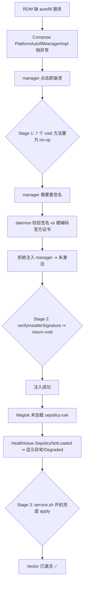

# 技术分析：为什么 Vector 在裁剪版 ROM 上「看起来是坏的」

本文记录在一台 **小米 Z10 手表（Wear 4100 系平台 + CaremeOS5）** 上从崩溃到完全可用
的完整排查过程。同类 ROM（多数 Wear 4100/5100 固件、各种「xx纯净版」手机 ROM）
大概率是一样的病因，可对照自查。

---

## 0. 症状链

```
打开 Vector manager
   │
   ├─ 手指一碰屏幕 → 卡住 → ANR → 进程崩
   │        └─ 病因 #1：ROM 没有 autofill 服务
   │
   ├─ 崩溃修好后，主界面停在「未激活」
   │        └─ 病因 #2：daemon 不信任重签名的 manager
   │
   └─ 有时显示黄色感叹号「异常 / Degraded」
            └─ 病因 #3：sepolicy 规则没被加载
```

三个问题互相叠加：只修 #1 会卡在 #2，只修 #2 会卡在 #3。**必须三处都到位**才显示「已激活」。

---

## 病因 #1：Compose 的 Autofill 委托在无 autofill 的 ROM 上直接崩

### 现场

```
E/AndroidRuntime: FATAL EXCEPTION: main
    java.lang.IllegalStateException: Could not locate AutofillManager from context
        at androidx.compose.ui.autofill.PlatformAutofillManagerImpl_androidKt
           .getPlatformAndroidManager(PlatformAutofillManagerImpl.android.kt:xx)
        at androidx.compose.ui.autofill.PlatformAutofillManagerImpl.notifyViewEntered(...)
        at androidx.compose.ui.autofill.AndroidAutofill.notifyViewEntered(...)
        at ...
```

先确认环境：

```console
$ adb shell dumpsys autofill
Can't find service: autofill
```

ROM 在裁剪时把 `autofill` 系统服务整个摘掉了，`context.getSystemService(AutofillManager::class.java)`
返回 `null`。

### 源码侧

`PlatformAutofillManagerImpl` 里每个方法都先通过一个内联工具取值：

```kotlin
internal inline fun <reified T> getPlatformAndroidManager(): T =
    context.getSystemService(T::class.java)
        ?: error("Could not locate ${T::class.java.simpleName} from context")
```

`error()` 抛的是 `IllegalStateException`，而且它发生在 Compose 的
**semantics → autofill 通知**链路上，这条链是在 UI 线程同步执行的，
没有任何兜底。于是任何可组合元素拿到焦点 / 发生可见性变化时（也就是你一碰屏幕），
整个 manager 进程挂掉。

### 修法

把类里所有会走到 `getPlatformAndroidManager()` 的 **void 方法**原地置为 no-op：

`cancel` `commit` `notifyValueChanged` `notifyViewEntered` `notifyViewExited`
`notifyViewVisibilityChanged` `requestAutofill`

这些方法语义上只是「通知一下 autofill」，本来也**没有** autofill 可通知，跳过零损失。

### 坑：不能直接删指令

`code_item` 结构要求尾部 padding 对齐到 4 字节。如果把指令数改少：

```
dex2oat : Non-zero padding before section
```

正确做法是**保持 `insns_size` 不变**，把前 n-1 条指令写成 `0x0000`（nop），
最后一条写 `0x000e`（return-void）：

```python
for i in range(insns_size - 1):
    struct.pack_into("<H", d, ins_off + i * 2, 0x0000)   # nop
struct.pack_into("<H", d, ins_off + (insns_size - 1) * 2, 0x000e)  # return-void
```

### 坑：dex 头两个校验值的写入顺序

```
header.checksum   (offset 0x08)  覆盖字节范围 [0x0c:]  → 包含 signature
header.signature  (offset 0x0c)  覆盖字节范围 [0x20:]  → 不包含上面两者
```

所以**必须先写 signature 再算 checksum**。反过来的话 checksum 是在旧 signature 上算的，
ART 会直接拒绝加载整个 dex（表现为 manager 启动直接崩，很容易误判成补丁打错了）：

```python
struct.pack_into("<20s", data, 0x0C, sha1(data[0x20:]).digest())
struct.pack_into("<I",   data, 0x08, adler32(data[0x0C:]) & 0xffffffff)
```

---

## 病因 #2：daemon 不信任「被重签名过」的 manager

### 现场

崩溃修好后界面能操作了，但：

```
状态：未激活
logcat: Skipped <pkg> ... no binder
```

### 调用链

```
ConfigCache.updateManager(pkg, ...)
    └─ ManagerService 解析 manager 的 UID / sourceDir
        └─ InstallerVerifier.verifyInstallerSignature(sourceDir)
                ├─ 读取已安装 manager APK 的签名
                ├─ 与 SignInfo.CERTIFICATE（编译时硬编码的官方证书）比对
                └─ 不一致 → 抛异常 → 上层跳过注入
```

这条检查的本意是防止第三方 manager 被注入。但 Stage 1 改了 dex，
**APK 内容变了就必须重新签名**，签名自然不可能等于官方证书。
于是「修好崩溃」和「通过签名校验」在数学上互斥 —— 除非改 daemon。

### 修法

```smali
.method public final verifyInstallerSignature(Ljava/lang/String;)V
    .registers 2
    .param p1, "path"    # Ljava/lang/String;
    .annotation system Ldalvik/annotation/Throws;
        value = { Ljava/io/IOException; }
    .end annotation

    return-void
.end method
```

只有两个调用方，都是「注入 manager 之前的自检」。放行后 daemon 照常把
`framework/vector.dex` 注入 manager 进程，日志出现：

```
Vector manager injected successfully
```

### 坑：为什么不用字节 patch

一开始试图在 dex 里直接把这个方法的指令改短（跟 Stage 1 一样的思路）。
但这个方法在 smali 层面需要 `.registers 2`，且它的位置在
debug_info / try_item 之间有依赖，缩短后 dex 分段错位，同样撞上：

```
dex2oat : Non-zero padding before section
```

正确做法是 **baksmali 反编译 → 改 `.smali` → smali 回编**，
dx 布局是重新生成的，天然干净。

> 注意：别图省事直接整文件覆盖 `InstallerVerifier.smali`。Kotlin 类的
> `@Metadata` 注解里含版本专属的 `d1`/`d2` 字符串表，跨版本覆盖会写错元数据。
> 本仓库做的是**方法级正则替换**，对上游变化更宽容。

### 坑：换 daemon.apk 后必须清 oat

```
/data/adb/modules/zygisk_vector/oat/   ← 删掉
```

否则 ART 会从旧 oat 缓存里加载原来的 `classes17.dex`，你的补丁永远不会生效。
表现为「明明 apk 换了，行为一点没变」。

### 坑：必须让 Magisk 拉起 daemon

手动 `nohup ./daemon &` 起来之后，它是没有正确的 SELinux 域/挂载命名空间的，
**注入不了 system_server**。必须让 Magisk 在开机阶段用
`unshare --propagation slave -m ./daemon` 拉起（模块自己的 `service.sh` 就是这么干的）。

---

## 病因 #3：sepolicy.rule 没被加载 → Degraded

### 现场

注入已经成功、功能也正常，但 manager 顶栏还是挂着警告。
反编译 manager 看状态判定逻辑（`HomeViewModel`），UI 在下面三种情况之一为真时显示异常：

| HealthIssue | 含义 |
| --- | --- |
| `SepolicyNotLoaded` | 必要的 selinux 规则没生效 |
| `SystemServerNotInjected` | system_server 没被注入 |
| `Dex2oatWrapperBroken` | dex2oat 包装损坏 / 权限不对 |

本机实际命中第一项。验证：

```console
$ su -c "magiskpolicy --live --apply /data/adb/modules/zygisk_vector/sepolicy.rule"
$ → 界面立刻变成「已激活」
```

原因：部分 Magisk 移植版（尤其手表 ROM 上的非官方构建）**不会自动执行模块的 `sepolicy.rule`**，
规则相当于从没被 apply 过。

### 修法

在 `service.sh` 里加一段幂等兜底，开机跑一次即可：

```sh
if [ -f "$MODDIR/sepolicy.rule" ] && command -v magiskpolicy >/dev/null 2>&1; then
    magiskpolicy --live --apply "$MODDIR/sepolicy.rule" >/dev/null 2>&1
fi
```

成本几乎为零，重复 apply 也没副作用。

---

## 完整修复关系图



---

## 排查清单（给别的设备用）

```console
# 1. 确认 ROM 是否缺 autofill
adb shell dumpsys autofill            # "Can't find service: autofill" ⇒ 需要 Stage 1

# 2. 看 manager 是否真的被注入了
adb logcat | grep -i "Vector manager injected"

# 3. daemon 在不在跑
adb shell ps -A | grep vectord

# 4. 模块里 APK 的 sha256 跟设备上装的是否一致
adb shell sha256sum /data/adb/modules/zygisk_vector/manager.apk
adb shell pm path org.matrix.vector.manager

# 5. sepolicy 是否生效（临时验证）
adb shell su -c "magiskpolicy --live --apply /data/adb/modules/zygisk_vector/sepolicy.rule"
```

更多排障见 [`TROUBLESHOOTING.md`](TROUBLESHOOTING.md)。
